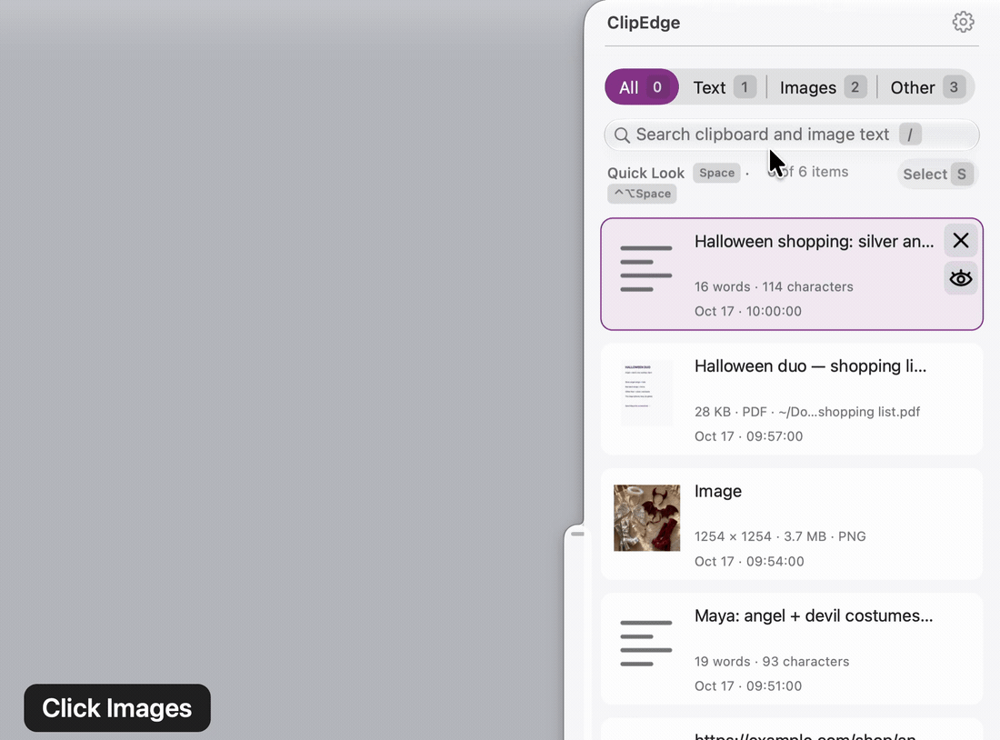
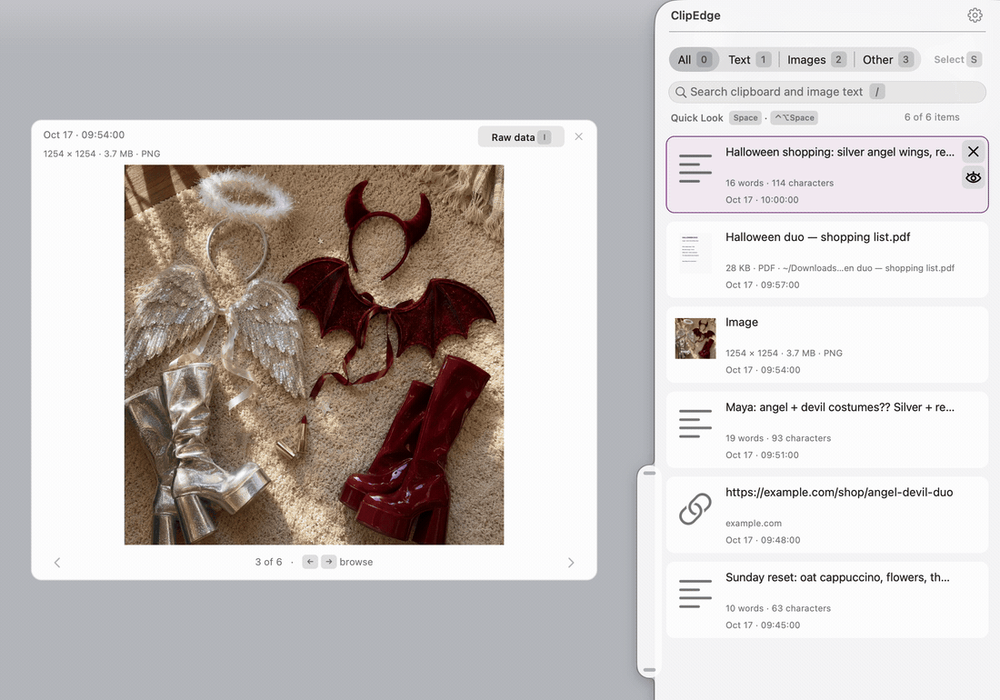

# ClipEdge

**A clipboard history for Mac newcomers and keyboard fiends alike.**

> **Copy now. Find it when you need it.**

<a href="docs/demo/demo.gif"></a>

ClipEdge remembers copied text, pictures, links and files. Reach for the drawer at your screen's edge, or open a searchable window without leaving your work.

**[Get ClipEdge →](#try-clipedge)** · [Latest release](https://github.com/clozach/ClipEdge/releases/latest) · [Controls](#first-launch-on-this-mac) · [MIT license](LICENSE)

## Keep your train of thought

- **Copy a few things. Paste when you're ready.** Retrieve earlier copies by mouse or keyboard. [Controls ↓](#drawer-controls)
- **Find the words inside a screenshot.** Search your history, including image text recognized on your Mac. [Search ↓](#search-and-previews)
- **Keep the original—or just the words.** Preserve formats, paste without styling, or combine several text copies. [Pasting ↓](#copying-and-pasting)
- **Keep your clipboard on your Mac.** No account, subscription, analytics or clipboard upload. [Privacy ↓](#privacy-and-storage)

## Try ClipEdge

**On a Mac with a coding assistant that can use Terminal**, paste this:

> Install https://github.com/clozach/ClipEdge using its latest signed release. Follow its AGENTS.md and complete the first-launch checks.

The assistant downloads, verifies and installs. You approve macOS permissions and choose automatic updates; Apple's Command Line Tools may need a first-time setup. **[Prefer Terminal or a direct download?](#install-with-chatgpt--codex)**

Free and open source. **macOS 14 or newer · Apple Silicon and Intel.** Releases are signed but **not notarized**; browser downloads need macOS's *Open Anyway* step. [Installation details ↓](#binary-downloads-and-publication)

## A little less “where did I put that?”

<a href="docs/demo/screenshot.png"></a>

Costume plans and the bits of a day. Both captures use the same [invented history](docs/demo/README.md). Click either for full size.

**Made for my mom. Kept for myself.** Built with ChatGPT and Claude to save her trips between windows—and satisfy my own keyboard habit. Used daily, personally maintained.

---

## Before you rely on it

- **Local history is not encrypted by ClipEdge.** Sensitive content can remain on disk or in backups. Copies explicitly marked concealed or transient are skipped; that is not a detector for every secret. [Privacy and storage](#privacy-and-storage)
- **macOS only.** No iPhone app or sync between Macs. Daily use is on Apple Silicon; the release also includes an Intel build.
- **Permissions matter.** Accessibility and Input Monitoring enable paste delivery and input observation. Approve them deliberately. [First launch](#first-launch-on-this-mac)
- **Deletion has limits.** Deleting a saved entry is not undoable in ClipEdge, and the oldest entries are automatically removed to meet its storage budget. Restoring an older app does not rewind your history. [Storage](#existing-tab-location-and-history) · [Undo an app update](#undo-an-update)
- **English-first, personally maintained.** There is no localization. [Issues and feedback](https://github.com/clozach/ClipEdge/issues) are welcome; a response or fix may take time or may not happen.
- **No complete independent code audit.** Use it with that limitation in mind.

The sections below are the operating manual.

## Install with ChatGPT / Codex

On the Mac that will run ClipEdge, use an assistant with local Terminal access and say:

> build https://github.com/clozach/ClipEdge

Read [AGENTS.md](AGENTS.md) for the agent's installation contract. A web-only chat cannot install software on your Mac. Run everything as the intended user, **without sudo**. This sets up that person's own app, settings and history.

**First prerequisite:** Apple's Command Line Tools. Check `xcrun --find swiftc`; if unavailable, run `xcode-select --install` and finish Apple's installer before continuing. No Homebrew, Node, `just`, paid Apple account or Xcode GUI is required.

Clone `https://github.com/clozach/ClipEdge.git` into a folder under your home directory (for example `~/Developer/ClipEdge`). From its root, install the latest release:

```sh
bash tools/install-release.sh
```

It downloads the release, checks its checksum and signature, moves any previous ClipEdge to the Trash, installs `~/Applications/ClipEdge.app` and opens it; a failure restores the previous app. The release is signed and offers automatic updates when enabled, and compatible signing normally retains macOS permissions across updates (see [Updates](#updates)). If the latest release is not such a copy, the script changes nothing and exits with status 3; build from source instead.

## Build from source

A copy built from the public repository never contacts the network and changes only when you rebuild it. For later updates reuse the same clean checkout, preserving any local edits. From its root:

```sh
bash tools/update.sh
```

The update command:

1. Checks for a standalone, clean Git checkout with an upstream before touching the app.
2. Asks running ClipEdge instances to quit and save. It stops if a save dialog prevents quitting; it does not force-kill them.
3. Moves previous ClipEdge bundles in `~/Applications`, `/Applications`, and any running ClipEdge location to the Mac's Trash. Unrecognized bundles or insufficient permissions stop the update. A protected `/Applications` copy may need to be moved to Trash in Finder first.
4. Runs `git pull --ff-only`, compiles and signs, verifies the signature, and installs in `~/Applications/ClipEdge.app`.
5. Opens the new app. If pulling, building or installing fails, it restores the old bundles from Trash. It prints the rollback receipt and command. Do not empty Trash until the update is accepted.

For source downloaded as a ZIP, or a development checkout nested inside another repo, skip Git updating:

```sh
bash tools/build.sh
bash tools/install.sh
open "$HOME/Applications/ClipEdge.app"
```

That path builds before quitting/replacing the old app. It uses the same Trash/rollback transaction. Both paths install the app only; neither deletes or imports a user's clipboard/settings.

## Drawer controls

Settings → **Hide drawer tab** hides the tab in both closed and open views. Underneath, **Keep drawer enabled** stays on initially: hover at the tab's usual screen-edge position, or use the menu or shortcut to open it. Turn it off to disable the drawer while keeping Clipboard History (⌥⌘\) and Quick Look. Showing the tab again restores its saved position.

**Show Clipboard / Hide Clipboard** is a display toggle. Its default global shortcut is **⌃⌥⌘Space** (Control–Option–Command–Space); record a different combination under _Global Show / Hide Clipboard shortcut_ in Settings. It stays open when the pointer moves away. A drawer you open Settings from, with its gear or by right-clicking its tab, also stays while Settings is open; once Settings closes, moving away closes it again. Press the command again to close. Esc steps out one level at a time: a held item (Quick Look's included), then selecting (every mark let go), then a search, then the drawer; with the keyboard in Quick Look's raw data, Esc first gives it back to the cards.

**Keys in the drawer.** While its cards hold the keyboard, single keys work as in Gmail: **0**–**3** show All, Text, Images and Other (each tab shows its key), **/** puts the keyboard in the search with its text selected (⌘F too), **,** opens Settings as the gear does, keeping the drawer open while Settings is, **S** selects several cards (**A** all of them; the selection's panel beside the drawer copies, opens or deletes them, asking first), **I** turns Quick Look to the card's raw data, and **T** puts the keyboard in its text (again for the next; Page Up and Page Down scroll it). The keypad's 0–3 work too; a comma typed with ⇧ still opens Settings, as a slash does on layouts that type it with ⇧. With any other modifier (⇧0, ⌥F and the like) they are ordinary keys, and in the search every character is text. The Option–Command–\\ window keeps **⌘0**–**⌘3** and **⌘F**: its search always holds the keyboard there, so a bare 1 types a 1. Wherever ClipEdge names a key after a word (a tab, a button, a hint), the key sits in its own darker cap, so *Images* [2] never reads as two images.

**Width and sliding.** Drag the drawer's free edge (the inner edge of a drawer at a side; either side edge of one at the top, which widens both ways) to make it wider or narrower. The width is kept with the tab's position, between what the drawer's contents need and 90% of the screen; a narrow drawer puts Select at the end of the count line. Drag the tab across its wall to pull the drawer open or push it shut by hand: let go and it finishes the way you flicked it, or, moving slowly, the way it was more than halfway to going. A drag along the wall still moves the tab, to another edge too.

Opening by hover or clicking the visible tab keeps the usual close grace, also while Settings is open; when a drawer opened over Settings closes, Settings gets the keyboard back. A hidden tab retains delayed hover; a saved _Click to open_ choice temporarily uses instant hover until the tab returns. Both directions slide over 300 ms, keeping the contents full-size; macOS **Reduce Motion** skips the slide. Settings changes apply immediately, stay open for comparison, and persist across relaunch. _Use Default_ reverses a shortcut change; toggling _Hide drawer tab_ off restores the tab. Settings scrolls on smaller displays.

Settings' seven number fields work alike: **Hover delay** under _Open the drawer_ (0–2 s, used only by _Delayed hover_; dimmed otherwise), **Maximum close delay** under _Close the drawer_ (0–3 s), under **Drawer motion**, how long opening and closing each take (0–1500 ms; 0 is at once; the default, 300 ms, is the slide described above), and under **Sizes**, **Text size** (80–200%: every ClipEdge window and panel draws its words, symbols and spacing that much larger, Settings included; the drawer keeps its width and lays out within it), **Thumbnail size** (50–300%: the picture at the start of each row; the row grows once the picture needs more) and **Preview size** (50–200%: Quick Look, beside the drawer and at the pointer). Each slide starts and stops softly; a slide already under way keeps the duration it started with. A dimmed field (the hover delay outside _Delayed hover_, both delays while the drawer is off) takes no drag, typing or undo, Tab passes it, and pointing at it says why it is dimmed. **Gestures:** drag a field's handle left or right to scrub (one step per point of drag, from the first press even while another window has the keyboard; the drawer takes each value as you drag, and letting go makes the drag one undo step); click or Tab into the number and its text is selected (letters are stripped, so `300ms` reads as 300 and `0.35s` as 0.35, and in a delay a comma is the point, so `0,5` reads as 0.5; Return keeps it and selects it again, Esc puts the old number back and leaves the field; leaving any other way keeps what was typed: Tab, a press anywhere else in Settings (another field's handle and Reset included), another window taking the keyboard (the number stays selected), or closing Settings); ↑/↓ nudge the kept number by one step (10 ms, 0.05 s for a delay, 5% for a size) and ⇧↑/⇧↓ by ten, dropping any number typed but not kept, with presses within a second counting as one undo step; **Reset ⌥⌘R** returns all seven to their defaults (0.35 s, 0.5 s, 300 ms, 300 ms, and 100% for each size), undoable field by field. Hovering or focusing a field shows **↺ ⌘Z** 9 points above its top-right corner once there is something to undo, and **↻ ⇧⌘Z** just left of it once something was undone; each keeps its place whether the other shows, and neither moves anything. The chords work on the field with the keyboard, and while one has it, only its magnets show; with no field holding the keyboard, they work on the hovered field. With a typed number not yet kept, the chords and the magnets undo and redo the typing first. ⌘A, ⌘C, ⌘X and ⌘V work in the fields as in the search. Esc with no field or recorder holding the keyboard closes Settings; a held Esc's repeats do not. Undo history lives in memory; only the current values persist. The chords for Reset, undo and redo are fixed; Settings cannot reassign them. The global history-window and plain-text-paste shortcuts are also fixed. The drawer toggle and Quick Look shortcuts are configurable.

## Updates

**A released copy** (installed by `tools/install-release.sh`, or downloaded from Releases) can keep itself up to date when you opt in:

- On first launch a small window asks once: _Keep ClipEdge up to date automatically?_ It does not take the keyboard, so typing elsewhere cannot answer it. The answer is a setting with no expiry: ClipEdge menu bar icon → **Updates** → _Update Automatically_ turns it on or off at any time. It makes no automatic update request before you opt in. You can also request a check yourself from the Updates menu.
- With updates on, ClipEdge checks GitHub once a day for the latest release; failed checks retry after an hour. Requests include the ClipEdge version and ordinary network metadata, but no clipboard content or analytics. A newer release is downloaded, and macOS checks that it is the same app signed by the same developer as the running copy. A download that fails that check, or that is not newer, is discarded and never opened.
- The update installs when ClipEdge is not in use: nothing held, no ClipEdge window open, and the keyboard and mouse still for two minutes. ClipEdge saves the history, swaps itself and reopens. The previous version goes to the Trash.
- Compatible signing normally preserves Accessibility and Input Monitoring approvals across updates. If macOS asks again, approve the installed app deliberately.
- **Updates** in the menu also offers _Check for Updates Now_, _What's New_ (the release notes) and _Go Back_ to the previous version while it is still in the Trash. Going back turns automatic updates off, so the older version stays.

**A copy built from source** has no update feed and never updates itself. An ordinary public source build makes no network requests. Its **Updates** menu says so and links to the release.

## Search and previews

Search works within All, Text, Images or Other. It matches text, item titles, copy times and text recognized in images by Apple Vision on your Mac. Files can also contribute text already indexed by Spotlight. Image recognition runs in the background; a newly copied picture may take a moment to become searchable. Web links are not fetched for previews.

**Other is for more than files.** Figma layers, Keynote slides and other app-specific clipboard formats are examples, not a closed list of supported apps. ClipEdge keeps an entry's captured formats together, names recognized data, and uses any picture it carries as a preview. Whether another app accepts a format depends on that app. A file entry points to the original file; moving or deleting that file can make it unavailable.

Quick Look uses the previewers already installed on your Mac. Declared rich text, JSON, Markdown, CSV, XML and other formats are handed to those previewers as typed files. ClipEdge has no separate extension marketplace. A Figma layer may show its file name, layer count and link rather than a rendered design; *Copy as PNG* in Figma supplies a picture.

## Copying and pasting

In the history window, **Return** reuses the selected item's saved clipboard formats and pastes into the app you were using. **Control–Command–Return** pastes its plain-text representation. **Control–Command–V** does the same for the current clipboard without opening ClipEdge. Plain text means words for text, paths for files, and descriptive facts for pictures; it is not an OCR-to-text command.

**Select** lets you mark several items and **Copy as text** or **Paste as text**, joining their plain-text representations with newlines in the order shown. It does not combine arbitrary rich objects into one rich paste. Selection also offers opening in Preview and confirmed deletion.

**I** in the drawer or **Command–I** in the window turns the preview over to the saved formats. You can inspect and copy an individual format. The display limits each text view to 64 KB and each binary preview to 512 bytes; its Copy action takes the full format (decoded text is copied as plain text).

## Privacy and storage

ClipEdge stores clipboard history locally and does not upload it. There is no account, analytics service or sync. Copies marked concealed or transient by the source app are skipped. Apps that do not mark a secret can still have it recorded: do not treat clipboard history as a password vault.

**History is not encrypted by ClipEdge.** Its saved text, pictures and app data can be read by someone or software with access to your user files, and may appear in your backups. You can delete entries or clear history, but ClipEdge cannot erase copies in backups, original files, or other apps' caches.

Public source builds make no network requests of their own. Released builds contact GitHub for [updates](#updates) when you enable automatic checks or ask for a manual check. Opening a copied link or sending an item to another app follows that app's behavior. The canonical maintainer build additionally checks publication status.

## Existing tab location and history

Updates retain **`local.codex.ClipEdge`** as the bundle identifier and **`ClipEdgeTabPlacement`** as the saved preference key. The original supplied app and the imported source use this identity; the original source and current app use the same placement schema (edge, center fraction, length and display ID). Replacing an `.app` does not remove these per-user preferences.

- Settings/tab position: `~/Library/Preferences/local.codex.ClipEdge.plist` (managed by macOS preferences).
- History: `~/Library/Application Support/ClipEdge/History.store/` (an index, then each item's formats in its own folder, and the text read from its pictures). A history saved before 2026-10-16 was one file, `History.plist`; the first launch of a newer ClipEdge copies it into the store and leaves the file as it was, so an older ClipEdge still opens it. Once you are happy with the newer one, you can move `History.plist` to the Trash.
- How much: a budget based on 1% of the free space on that disk (refreshed as copies arrive, at most once a minute), oldest entries removed first; at most 20,000. The newest entry is kept even if it alone exceeds the budget. When 1% of free space is under 1 GB, a 💾⚠️ appears before the item count in the drawer and the Option–Command–\\ window; rest the pointer on it for the disk as one bar: *Used*, *ClipEdge* and *Free*, each with its size and percent. Resting the pointer on the item count shows the same bar, without the warning, whatever the free space.
- Missing/rearranged display: the app chooses an available display and clamps the tab to its usable area. Exact screen coordinates can therefore change with display configuration.

Before an update, note the visible tab's edge/location. After it opens, compare. **Do not run `defaults delete`, copy another person's preferences/history, or delete Application Support to troubleshoot installation.** If an older app has a different bundle identifier or schema, stop and inspect its settings before migration; do not promise preservation by name alone.

## First launch on this Mac

macOS permissions belong to this user and this app's signature, not to the source repository. Compatible signing normally keeps approvals across release updates. A copy built without a certificate gets a new signature with every build.

1. In System Settings → Privacy & Security, grant ClipEdge **Accessibility** and **Input Monitoring** when requested for paste detection/delivery. Quit/reopen after changing grants. Permission prompts cannot be approved by a README or copied from another Mac. Moving from an ad-hoc local build to the signed release may require reapproval. If macOS requests it or input stops working, remove the old ClipEdge entry (−) in both lists, approve the installed copy, then reopen it.
2. If a locally built update stops receiving input, remove/re-add the installed ClipEdge in those permission lists. A stable signing certificate can reduce repeated approvals; `CLIPEDGE_SIGN_IDENTITY` selects a local code-signing identity. The build otherwise selects a sole valid identity, or warns and uses ad-hoc signing.
3. Copy harmless test text. Check history, All/Text/Images/Other search, and **Control–Option–Space** for Quick Look. In the drawer, Space toggles preview and arrows follow the visible tab/search results. While an item follows the pointer, Command-click an empty editable document to paste it there; a plain click keeps holding the item, and Command-click on a link or list row keeps its usual meaning. Accessibility policy tests do not substitute for this physical check. Then press **Option–Command–\\** in any app: the history window opens with an empty search and the newest item selected (the drawer, too, opens with an empty search, on the tab it had unless something copied since it last opened would be hidden there; then on All). Type to search; the same shortcut or the arrow keys choose; Command–0 to 3 show All, Text, Images or Other. Return pastes into the app you were in, Control–Command–Return pastes plain text, Command–C picks the item up without pasting, Command–O opens it in Preview, Tab offers apps to send the item to (Left Arrow goes back), Command–Delete twice deletes the item for good (holding it down counts as one press). Command–S selects several (Return or a click marks each, Shift–Command–A all of them), and the selection's panel copies, pastes, opens or deletes them, asking first; selecting all and deleting, or using the menu bar's Clear History, can remove the whole history. Command–I turns the card over to its raw data, where Command–T moves the keyboard from text to text (the arrows move in it, with Shift they select) and Page Up and Page Down scroll. Escape steps out one level at a time: a waiting delete, the raw data's text, the turned card, selecting, the search, then the window. **Control–Command–V** pastes the clipboard as plain text with no ClipEdge window open.
4. In Figma in Chrome, copy a layer: ClipEdge titles it "1 Figma layer from" its file and explains it. Paste it back into Figma with Return or Command–V; Control–Command–V pastes a link to the layer instead. Copy a text layer: ClipEdge titles it by its words, lists it under Text and Other, and Control–Command–V pastes its words. Copy a slide in Keynote (or anything from an app with its own clipboard format): ClipEdge shows its picture, names the app among its facts ("iWork data · 3 formats"), lists it under Images and Other, and its card lists every format; a copy without a picture reads "iWork data" with a box symbol. Return pastes it back into Keynote unchanged.
5. In either search, type a word, press **Command–A**, then type another: the word is replaced. Command–X cuts the selected search text, Command–V pastes text into the search, Command–Z undoes and Shift–Command–Z redoes. In the drawer's search, Command–C copies the selected text; in the history window, Command–C keeps its clipboard-item pickup action.
6. Confirm the tab remains where it was. Choose **Open at Login** in the ClipEdge menu if wanted. Optional Dock pin: `xcrun swift tools/pin-dock.swift`. The app runs outside Command-Tab; its Dock pin is a launch target.

Verify package integrity with:

```sh
codesign --verify --strict "$HOME/Applications/ClipEdge.app"
```

A valid signature is not a claim of Apple notarization or granted permissions. Report the installed app version and release tag, signing mode and any remaining first-launch steps. For a source build, also report its source commit (`git rev-parse --short HEAD`); a release installer's checkout commit does not identify the downloaded app.

## Undo an update

The command printed at installation uses a private `.build/install-…json` or `.build/update-…json` receipt:

```sh
.build/installer restore "/full/path/to/the/printed/receipt.json"
```

It quits ClipEdge, moves the new app to Trash and restores prior bundles to their original locations without overwriting another file. Then open the restored app. Keep the receipt and Trash contents until satisfied. If the command is interrupted or a restore destination is occupied, use the receipt's `original`/`trashed` paths to finish the restore in Finder. Old app restoration does not rewind subsequent history changes.

## Binary downloads and publication

Created by **Chris Lozac'h** (<clozach@gmail.com>), with direction through prompting, a personal knowledge vault and development tooling, assisted by ChatGPT.app and Claude.app. Code and the bundled icon are released under the [MIT License](LICENSE). See [icon provenance](Resources/README.md).

[The latest release](https://github.com/clozach/ClipEdge/releases/latest) is a universal ZIP for Apple Silicon and Intel with a `SHA256SUMS` file. `bash tools/install-release.sh` checks the checksum and signature before installing. This scripted download does not carry the browser quarantine mark; it does not turn off Gatekeeper or notarize the app.

To install a ZIP downloaded in a browser by hand: quit ClipEdge using its menu, move the previous `.app` to Trash, unzip the download, and move `ClipEdge.app` into your own `~/Applications` folder. The release is signed but **not notarized**, so macOS blocks a browser download at first launch; allow it under Privacy & Security → Open Anyway only for a release you trust. Do not disable Gatekeeper/SIP or recursively strip quarantine. Leave Library preferences/history in place; keep the old app in Trash until the new one works.

`bash tools/release.sh` prepares that ZIP and checksum under `.build/releases/`, signed with the maintainer's certificate and a signing timestamp, and carrying the update feed. It refuses to build an unsigned release: such a copy cannot meet the signed-update contract, and ad-hoc builds can require permission reapproval after rebuilding. [CHANGES.md](CHANGES.md) holds the notes each release publishes; `VERSION` holds the version number.

Releases are built locally and uploaded to GitHub. This project does not provision a paid service or signing certificate automatically. See [Apple’s membership options](https://developer.apple.com/support/compare-memberships/) for Developer ID signing and notarization.

## Development

```sh
bash tools/test.sh          # native fixture regression checks
bash tools/test-search-editing.sh # quit ClipEdge first; real panel events, fixture captures, clipboard returned
bash tools/test-install.sh  # isolated install, failure and rollback checks
bash tools/test-update.sh   # local Git + mocked app update/failure checks
bash tools/test-self-update.sh  # a stand-in app updates itself, reopens and goes back (needs a signing certificate)
bash tools/build.sh         # current architecture; macOS 14 deployment target
```

`just build/test/install/run/demo/watch` are optional conveniences. Only the watcher requires Node. Fixture/demo use must begin with normal ClipEdge quit: the app has one global shortcut/preview directory. `--demo` uses a named clipboard and disables cross-app delivery; `--demo-web-copies` adds made-up browser copies (Figma layers, HTML-only and rich text); `--demo-sample-history` shows a throwaway copy of your [sample history](#sample-history) in place of the invented fixtures. Tests use invented copies only. Public screenshots use invented copies only; your own curated sample is for private captures. [README demo provenance and recording recipe](docs/demo/README.md) document the fictional history and native capture.

`tools/export-source.sh NEW_DESTINATION` copies an allowlist of portable code/tests/tooling for publication. It includes the README, its fictional demo assets, their portable capture recipe and the contributor checklist. It excludes private development history, evidence, machine-specific capture recipes, build products and the old Finder-icon backup. The public repository is a distribution snapshot exported from the maintainer’s canonical development source. Upstream contributions are reconciled there before the next release; avoid independent, divergent edits. Every source change includes a README review under [AGENTS.md](AGENTS.md#readme-review-on-every-source-change), updating affected claims and media in the same change or recording why no documentation change is needed.

## Sample history

A second history for screenshots, decks and videos, so they show copies you chose rather than whatever you copied last.

- **Switch.** Hold Option in the ClipEdge menu bar menu and choose **Use Sample History** (it stands in for *Save History Now*). The menu bar icon becomes theater masks and the menu's first item reads *Showing Sample History · Use Real History*. The choice survives relaunch.
- **First switch seeds it.** Up to six passages of text (six words or more), four Figma copies, four links and four pictures from your own history, newest first. Files and app data stay out. If a kind is missing from your retained history, the sample starts without it.
- **Edit it by using it.** While the sample shows, a copy joins it and a delete removes it, and both are saved. Your own history is saved on the way in and not touched until you switch back; copies made meanwhile land in the sample only.
- **Add from your own history.** In your own history, hold Option: *Clear History* becomes **Add “…” to Sample History**, naming the newest item. It reads *“…” Is in Sample History* once it is there.
- **Reorder from Terminal.** With ClipEdge on your own history (it refuses otherwise, since a running sample would save over the edit):

```sh
ClipEdge=~/Applications/ClipEdge.app/Contents/MacOS/ClipEdge
$ClipEdge --sample-history list          # numbered, 1 at the top
$ClipEdge --sample-history move 5 1      # entry 5 to the top
$ClipEdge --sample-history remove 3      # the previous file goes to the Trash
$ClipEdge --sample-history seed --replace  # start over; the old sample goes to the Trash
```

It lives at `~/Library/Application Support/ClipEdge/Sample/History.store/`, beside your own history, with the same permissions; it keeps its own 50 items, whatever the disk's space. It holds real clipboard content, so it never belongs in a repository; the source export cannot reach it.

## Maintainer publication

The canonical development checkout can build a **maintainer copy**. Its drawer and history window show a bright pink **Publish… ⇧⌘P** button when the running app differs from the latest published app. It compares the app’s code, resources and build recipe, so reusing a version number does not hide unpublished work. Ordinary public builds and released copies have no publishing capability.

Clicking Publish (or pressing Shift–Command–P in either view) freezes the matching source, runs the automated regression/install/update checks, and builds a signed universal release once. The review shows the proposed version and release notes. **Cancel** is the default; **Command–Return** explicitly publishes the reviewed candidate. Publication reuses those frozen bytes, checks that the previous public release has not changed, and checks the published result before hiding the button. Preparing and cancelling leaves a candidate available for review. After a restart the helper can reuse it when its content, notes, version and prior-release baseline still match. A failed publication can retry that same candidate.

A gray **Check release** control means the comparison is unavailable, for example while offline. **Rebuild needed** means the editable source no longer matches this running copy: rebuild/install it before preparing a release. Status refreshes on launch, on opening either view (with a one-minute cache), and every five minutes. A hidden control does not prove another Mac has installed the release. Local and release version labels can differ (for example 2.3 and 2.3.1) while the app contents match.

While preparing or publishing, the button fills as the helper finishes each step. The helper appends one JSON line per step to a progress file the app names with `--progress-file`; the pace between lines comes from the step durations of recent runs, kept in `.build/publisher/telemetry.json`. The tooltip names the current step.

A pull request merged on GitHub can leave public `main` ahead of the latest release. Apply the same change to this canonical source and rebuild; preparation and publication accept public commits whose changes the candidate already contains, and stop with the commits named when it does not. The release commit is added on top of public `main`, keeping the contributor's commit.

Local builds, private commits and pushes do not publish. Release notes come from `CHANGES.md`’s `Unreleased` section or the chosen next-version section; the next patch version is selected when necessary. The maintainer helper lives only in the canonical checkout and requires GitHub CLI access, Git and the compatible signing certificate. Public exports exclude the helper.

For command-line use, `bash tools/publisher.sh status --running-fingerprint <installed-content-fingerprint>` checks status; `prepare` with the same argument creates a candidate and returns its review fields. Publication requires the returned candidate ID, content fingerprint, archive SHA-256, complete receipt SHA-256 and explicit `--approve`. The former bare `publish-release.sh --publish` command refuses to rebuild and publish implicitly. No approval means no release.

## Maintainer: Ask for a preview

Quick Look already draws rich text, JSON, Markdown, CSV, XML, property lists, source code and other declared formats as typed files (`Clipboard.rtf`, `Clipboard.json`), using the previewers installed on the Mac; the card and an item's info say which format it shows. For a copy ClipEdge still shows poorly, the maintainer copy offers **Ask for a preview ⌥⌘A** in the history window's footer and on a selected drawer tile. A small form takes one optional line (_What should a better preview show?_); **Write brief ⌘⏎** writes `projects/clipedge-preview-<name>/AGENTS.md` (`<name>`: the app named by its own format, else the copy's kind — text, image, file, figma, clipboard-item) into the vault that holds this source (found from the publisher tool's path and refused anywhere else), as an `unstarted`, `parked` project: the copy's formats with their byte sizes, whether a picture or text is present, what Quick Look is handed today, what ClipEdge shows today, the note verbatim, where the code lives, how to test and the Definition of Done, and never the copy's content. The form's place then names the brief, with **Open in Obsidian ⌘⏎** and **Copy prompt ⌥⌘C** (marked transient, so ClipEdge never records it); **Back** returns to the item; in the drawer, the form's buttons wrap onto a second row when they do not fit its panel. Asking again about the same app, or about another copy of the same kind, appends a dated request to the same project while it is open; once that project is completed or abandoned, a new dated brief is written beside it. A failure (no vault, nothing writable) is a sentence in the same place. Ordinary and released copies have no such control, and the key does nothing there.

### Keyboard layouts and row details

Search editing (Command–A/C/X/V/Z and Shift–Command–Z), Ask’s Option–Command–C and Publish’s Shift–Command–P use the shared layout-aware matcher. Latin layouts follow their letters; non-Latin layouts use the corresponding key positions. VoiceOver hears the names of the drawer’s shortcuts, Publish’s chord and preview arrows. Rest the pointer on a compact history row to read its complete text, facts and paths without entering Select. Small-magnet captions have transparent backgrounds.
